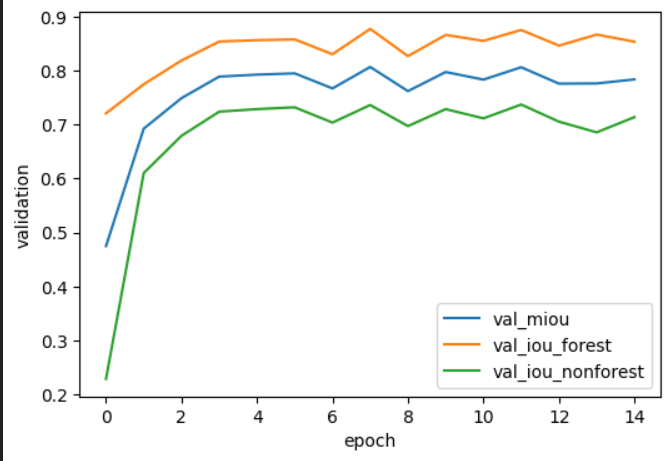
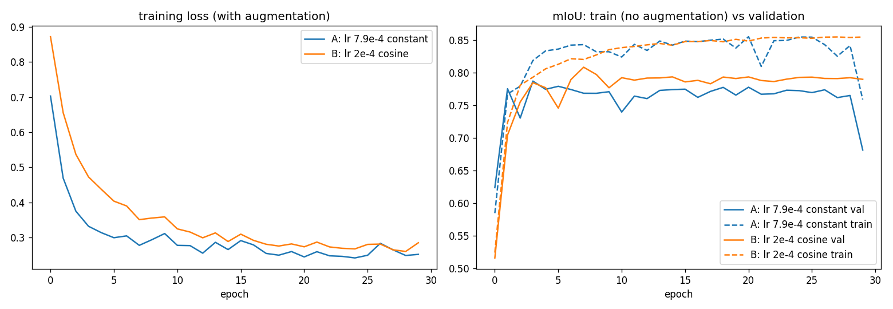
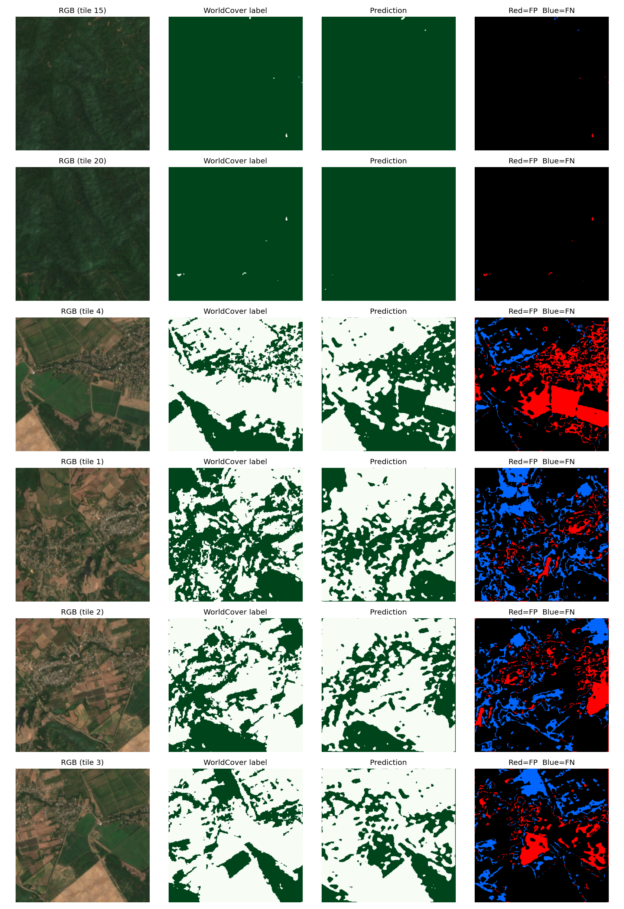
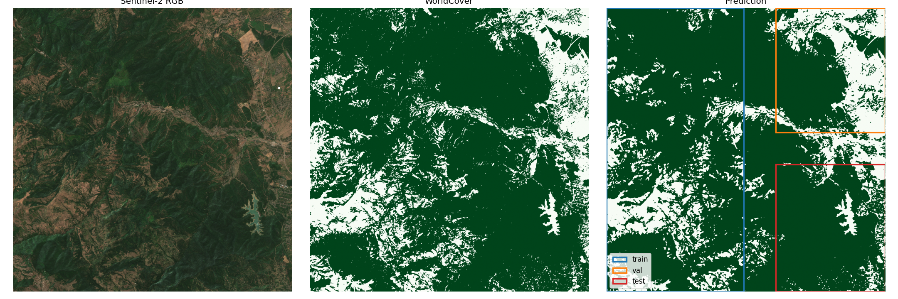

# Forest segmentation on Sentinel-2 (Lankaran region, Azerbaijan)

A U-Net (ResNet34 encoder, 4 spectral bands) that labels every 10 m pixel of a Sentinel-2 scene as
forest or non-forest, trained against ESA WorldCover 2021 "tree cover". The predicted mask is
vectorized into polygons with areas in hectares. It is a time-boxed portfolio experiment built only
on free tools (Kaggle T4 GPU, Microsoft Planetary Computer, MLflow, Optuna).

The emphasis of this repository is **honest evaluation**: a three-way geographic split with buffer
zones, a test block that no decision was based on, an all-forest baseline next to every score,
learning curves, seed checks on the hyperparameter search, three independent runs of the whole
pipeline, and a list of everything that limits the result.

## Headline results

| Split | Evaluation method | Forest IoU | Non-forest IoU | mIoU | All-forest baseline mIoU |
|---|---|---|---|---|---|
| Validation (used for checkpoint and hyperparameter selection, so optimistic) | 256 px tiles, 30 overlapping tiles | 0.878 | 0.736 | 0.807 | 0.350 |
| **Test, Run 3 (final model in this repository)** | block-wise sliding window | **0.946** | **0.584** | **0.765** | 0.446 |
| Test, Run 2 (an independently trained earlier model, same split) | block-wise sliding window | 0.937 | 0.594 | 0.766 | 0.446 |

- The model clearly beats the trivial "everything is forest" baseline: test mIoU 0.765 against
  0.446. Two independently trained models gave the same test mIoU (0.766 and 0.765).
- The test block is 89% forest, so its forest IoU is inflated by class imbalance (a constant
  "forest" prediction already scores 0.892). The informative numbers there are **non-forest IoU
  and mIoU**, and non-forest IoU rests on only about 960 ha of non-forest area (10.8% of the block).
- Test mIoU is about 0.04 below validation mIoU. Part of that is selection optimism (the validation
  score is the maximum over noisy epochs) and part is that non-forest shrinks from 30% of the
  validation block to 11% of the test block.
- Hyperparameter tuning gave at most a small, inconsistent gain; the learning curves point to data
  and label quality as the ceiling (details below).

## Key findings

1. **Dense forest is segmented almost perfectly; the mixed farmland-and-village strip is hard.**
   Validation error is about 4% in forest-interior tile rows and 22% in the northernmost strip,
   where only 46% of the label is forest. The same strip was the worst area in all runs.
2. **The result replicates.** Two independently trained models (different configurations and
   checkpoints) scored the same test mIoU (0.766 and 0.765).
3. **Systematic bias is not stable between runs.** One model under-predicted forest (false
   negatives 8.5% of validation pixels vs false positives 2.3%) and matched the total forest area
   to the hectare through cancelling errors; the final model is balanced on validation (4.6% vs
   4.5%) but over-predicts total forest area by 3.7%. Area agreement with WorldCover should not be
   read as accuracy.
4. **Validation scores plateau after about 3 epochs and then bounce by roughly +-0.02.** Picking the
   best epoch on 30 overlapping tiles selects noise; the test score did not care (see item 2).
5. **A high constant learning rate is unstable here.** A diagnostic run with lr 7.85e-4 had training
   and validation mIoU collapsing at some epochs, while lr 2e-4 with cosine decay settled at a
   stable plateau of about 0.79 validation mIoU.
6. **Tuning did not clearly help**: gains over the default were +0.017, -0.001 and +0.024 mIoU in
   three searches, against seed-to-seed spread of 0.02-0.04. The tuned runs did vary less between
   seeds in all three searches.

## Data and labels

| Item | Value |
|---|---|
| Imagery | Sentinel-2 L2A, June-August 2021, scene cloud cover < 20% (143 scenes), per-pixel median composite |
| Bands | B04 (red), B03 (green), B02 (blue), B08 (near-infrared), digital numbers divided by 10,000 |
| Grid | 10 m, EPSG:32639 (UTM 39N), 2232 x 2276 pixels (about 22 x 23 km) |
| Area of interest | bbox [48.55, 38.60, 48.80, 38.80], Lankaran lowlands and Talysh forest foothills |
| Labels | ESA WorldCover 2021, class 10 ("Tree cover") = forest, everything else = non-forest, resampled onto the Sentinel-2 grid with nearest neighbour |
| Forest share | 77.8% of the scene (3,951,300 forest pixels, 39,513 ha) |

The two rasters were verified to share transform, shape and CRS (`gdalinfo`, `rasterio`). All three
runs used the same files (same grid and label totals).

**Label caveat:** WorldCover is itself a model-derived product, partly built from Sentinel-2, so the
network learns to imitate it rather than to match ground truth, and agreement may be partly circular.

## Experimental design

```
            cols 0 ... 1100  |  256 px gap  |  cols 1356 ... 2232
rows 0 .. 1000    TRAIN      |              |   VALIDATION
rows 1000..1256   TRAIN      |              |   (256 px buffer, unused)
rows 1256..2276   TRAIN      |              |   TEST
```

| Block | Pixels (rows x cols) | Label forest share | Used for |
|---|---|---|---|
| Train | 2276 x 1100 | 0.775 | Fitting the weights (112 tiles of 256 x 256, stride 128) |
| Validation | 1000 x 876 | 0.700 | Per-epoch monitoring, checkpoint choice, hyperparameter search (30 tiles, stride 128) |
| Test | 1020 x 876 | 0.892 | Final evaluation of finished models |

- A **256 px (2.56 km) buffer** separates every pair of blocks. Tiles never cross a block edge. Both
  properties are enforced by unit tests.
- Input bands are normalized with **training-block statistics only**.
- The test block was **not tiled** during development and was predicted only after a final model had
  been chosen. **No model, threshold, split or setting was changed after seeing a test result.**
- The test block was scored **twice**, by two independently trained models (Run 2 and Run 3,
  identical protocol). Both results are reported above; neither was picked for being better.
- Buffers reduce but do not remove spatial autocorrelation, so this test is weaker than an
  independent region would be (see [Limitations](#limitations)).

## Model and training

| Item | Value |
|---|---|
| Architecture | U-Net, ResNet34 encoder with ImageNet weights, 4 input channels, 1 output channel (`segmentation_models_pytorch`) |
| Loss | Dice + `bce_w` x binary cross-entropy |
| Optimizer | AdamW, constant learning rate (no schedule) |
| Augmentation | random 90-degree rotations and horizontal flips |
| Final settings (Run 3) | lr 4.80e-4, weight decay 2.44e-4, `bce_w` 1.474, batch size 16, 15 epochs, seed 0 |
| Checkpoint | best validation mIoU, reached at epoch 7 (counting from 0) |
| Inference | threshold 0.5; block prediction uses 256 px windows at stride 128 with averaged probabilities (42 windows for the test block) |

## Results in detail

### Validation (final model, best epoch)

| Metric | Value |
|---|---|
| Forest IoU / non-forest IoU / mIoU | 0.878 / 0.736 / 0.807 |
| Forest Dice / pixel accuracy | 0.935 / 0.909 |
| False positive / false negative pixels | 4.51% / 4.62% |
| Non-forest recall / precision | 0.850 / 0.847 |
| All-forest baseline (accuracy = forest IoU) | 0.700 |

### Test

| Metric | Run 3 (final) | Run 2 | All-forest baseline |
|---|---|---|---|
| Forest IoU | 0.946 | 0.937 | 0.892 |
| Non-forest IoU | 0.584 | 0.594 | 0.000 |
| mIoU | 0.765 | 0.766 | 0.446 |
| Non-forest share of block | 10.8% (about 960 ha) | | |

Test inference covers the whole 1020 x 876 block (about 8,935 ha) and scores every non-nodata pixel.
The test set is **one contiguous block, not many independent samples**, so the non-forest IoU is a
noisy estimate (a different 960 ha of non-forest could move it by several points). Replicating the
score with a second model shows stability to training noise, not generalization to new regions,
because both models were scored on the same block.

**Validation and test are not computed identically.** Validation during training uses discrete tiles
without overlap averaging, while the test uses block-wise sliding-window inference with averaged
overlaps (the same function that produces the forest map). As a rough check, scoring the validation
block with the sliding-window function (windows may read neighbouring pixels) gives forest IoU 0.847
and non-forest IoU 0.750 (mIoU about 0.80), against 0.878 / 0.736 (0.807) from the tile-based
evaluation. The method moves per-class scores by 0.01-0.03 but barely moves mIoU.

### Learning curves



**Final run, validation per epoch (values read from the plot, approximate).** Validation mIoU rises
from about 0.47 (epoch 0) to about 0.79 by epoch 3, then plateaus and bounces between roughly 0.76
and 0.81. The logged maximum is 0.807 at epoch 7. Selecting the best of 15 epochs on this curve
picks a noise peak.



**Diagnostic run: 30 epochs, training metrics logged** (batch size 8, `bce_w` 1.255, weight decay
1.3e-4; values read from the plot, approximate). Note that setting A is the winner of an *earlier*
search (Run 2), not the final Run 3 configuration (lr 4.8e-4, batch 16), so the diagnostic shows the
behaviour of a high learning rate in general rather than of the final model exactly.

| | A: lr 7.9e-4, constant | B: lr 2e-4, cosine decay |
|---|---|---|
| Training loss (with augmentation) | falls to about 0.25 by epoch 15 | falls more slowly to about 0.28 |
| Train mIoU (no augmentation) | rises to about 0.85, dips to about 0.81 at epoch 21, drops to about 0.76 at epoch 29 | rises smoothly to about 0.85 and stays |
| Validation mIoU | zigzags between 0.74 and 0.78, falls to about 0.68 at epoch 29 | peak of about 0.81 at epoch 7, then stable at about 0.79 |

What the curves show:

- **The model learns**: training loss falls from about 0.9 to about 0.3 and training mIoU reaches
  about 0.85 in both settings.
- **Setting A is unstable**: both training and validation mIoU collapse at isolated epochs while the
  training loss looks normal. A plausible mechanism is unstable BatchNorm statistics under a high
  learning rate at batch size 8, but this was **not tested**.
- **A stable run plateaus at about 0.79 validation mIoU**, about 0.02 below the best-epoch values
  (0.807-0.815) reported for the checkpoints, which is a rough estimate of how optimistic checkpoint
  selection on this validation set is.
- **The train-validation gap is modest** (about 0.06 mIoU, partly because the validation block has
  30% non-forest against 22% in train), and training mIoU itself plateaus near 0.85. The model does
  not fit even its own training area well, which points to label noise and 10 m resolution rather
  than memorization.
- Together with the flat hyperparameter search, this suggests the ceiling is set by **data and
  labels, not by the settings searched**.

### Hyperparameter search (Optuna, tracked in MLflow)

TPE sampler (seed 0), 20 trials of 8 epochs each, optimizing validation mIoU. Search space: encoder
{resnet18, resnet34}, learning rate 1e-4 to 1e-3 (log), weight decay 1e-5 to 1e-2 (log), `bce_w`
0.25 to 2.0, batch size {8, 16}. Trial 0 was the default configuration (resnet34, lr 3e-4,
weight decay 1e-2, `bce_w` 1.0, batch size 16).

| | Run 3 validation mIoU |
|---|---|
| Default configuration (trial 0) | 0.798 |
| Best trial (trial 18: resnet34, lr 4.8e-4, batch 16) | 0.809 |
| Median / min / max of 20 trials | 0.797 / 0.758 / 0.809 |

The best of 20 noisy scores is optimistically biased (the "winner's curse"), which is why the seed
check below matters.

### Seed check

Default and tuned settings, 8 epochs, three fresh seeds each (validation mIoU, population std):

| | Seed 1 | Seed 2 | Seed 3 | Mean | Std |
|---|---|---|---|---|---|
| Default | 0.784 | 0.726 | 0.817 | 0.776 | 0.038 |
| Tuned | 0.799 | 0.781 | 0.820 | 0.800 | 0.016 |

Tuned beat default on all three seeds here, but by +0.015, +0.055 and +0.003, and most of the gap
comes from one poor default run (seed 2). With three seeds and a default spread of 0.038, this is
suggestive, not conclusive.

### Three runs of the whole pipeline

The whole pipeline (search, seed check, final training) was run three times on the same data and
split. Run 1's final model was lost when its session ended, before any test evaluation. Run 2 and
Run 3 were evaluated on the test block. All identical code and seeds; GPU training is not
bit-reproducible.

| | Run 1 | Run 2 | Run 3 (final) |
|---|---|---|---|
| Trial 0, default config | 0.798 | 0.798 | 0.798 |
| Trial 1, identical config in every run | 0.811 | 0.798 | 0.798 |
| Best trial in the search | 0.811 | 0.808 | 0.809 |
| Winning config (lr, batch size) | 4.0e-4, 8 | 7.9e-4, 8 | 4.8e-4, 16 |
| Seed check, default: mean / std | 0.781 / 0.034 | 0.781 / 0.024 | 0.776 / 0.038 |
| Seed check, tuned: mean / std | 0.798 / 0.009 | 0.780 / 0.007 | 0.800 / 0.016 |
| Final model validation mIoU (best epoch) | 0.815 (4) | 0.786 (1) | 0.807 (7) |
| Validation false positive / false negative | 3.9% / 4.9% | 2.3% / 8.5% | 4.5% / 4.6% |
| Test mIoU | not evaluated | 0.766 | 0.765 |
| Whole-scene predicted vs label forest area | not computed | 0.0% | +3.7% |

- The winning configuration differs every time, another sign the search surface is flat.
- Tuned minus default mean was +0.017, -0.001 and +0.024 (average +0.013); tuned runs varied less
  between seeds in all three runs (std 0.007-0.016 vs 0.024-0.038).
- The best epoch ranged from 1 to 7 and validation mIoU from 0.786 to 0.815 across final models, yet
  test mIoU was 0.766 and 0.765. Validation-based checkpoint choice is noise on a plateau; held-out
  performance was stable.
- Error bias and total area varied between runs, so these properties of a single model should not be
  over-interpreted.

### Error analysis (validation block, final model)

Error by position, from the 30 validation tiles (6 tile rows x 5 tile columns, stride 128):

| Tile row (scene rows) | Label forest | Predicted forest | Error | False positive | False negative |
|---|---|---|---|---|---|
| 0 (0-256) | 0.46 | 0.43 | 0.217 | 0.095 | 0.122 |
| 1 (128-384) | 0.60 | 0.60 | 0.131 | 0.067 | 0.063 |
| 2 (256-512) | 0.72 | 0.74 | 0.062 | 0.040 | 0.023 |
| 3 (384-640) | 0.78 | 0.79 | 0.042 | 0.025 | 0.017 |
| 4 (512-768) | 0.83 | 0.82 | 0.037 | 0.018 | 0.020 |
| 5 (640-896) | 0.82 | 0.81 | 0.059 | 0.026 | 0.033 |

- **Error falls as the forest share rises**, from 22% in the northern mixed strip to about 4% in
  the forest interior.
- In this model the predicted forest share tracks the label closely in every row; false positives
  and false negatives are balanced overall (4.5% / 4.6%).
- The worst tiles are 4 (0.260), 1 (0.245), 2 (0.219) and 3 (0.189), all in the top tile row and
  neighbours overlapping by 50%, so they are **one failure strip seen several times, not independent
  failures**. The best tiles are 15 and 20 (0.001, continuous dense forest).

Failure modes, as observed in the error figure of **Run 1** (same data and split; worst tiles were
in the same village-and-farmland strip). Run 3's figure was not inspected in detail, and the causes
are plausible hypotheses that were not tested:

1. Green irrigated crop fields predicted as forest. In a June-August composite, crops can resemble
   canopy in both visible and near-infrared bands.
2. Sparse or dry vegetation that the label counts as forest and the model misses. Whether the label
   or the model is right here cannot be decided from 10 m imagery.
3. Thin boundary errors around settlements, from mixed pixels, very fragmented labels and smoother
   predicted masks.



### Forest map and area



Whole-scene prediction (train, validation and test windows all included; the frames in the figure
mark the three blocks):

| Quantity | Value |
|---|---|
| Predicted forest, raster | 40,984 ha |
| Predicted forest, polygons >= 1 ha | 40,846 ha (115 polygons) |
| WorldCover forest | 39,513 ha |
| Pixels where prediction and label disagree | 357,877 of 5,080,032 (7.0%) |

The model **over-predicts total forest area by 3.7%** (4,098,359 vs 3,951,300 pixels), and it does so
in every region:

| Region | Predicted | Label | Difference |
|---|---|---|---|
| Train block (in-sample) | 20,246 ha | 19,274 ha | +972 ha (+5.0%) |
| Validation block | 5,588 ha | 5,493 ha | +95 ha (+1.7%) |
| Rest (gaps and test block) | 15,149 ha | 14,745 ha | +404 ha (+2.7%) |

Block-wise whole-scene scores (windows may read pixels across block edges): train block forest IoU
0.916 / non-forest IoU 0.717 (in-sample; a model that was memorizing its training area would score
far higher); validation block 0.847 / 0.750.

For comparison, Run 2's total area matched WorldCover to the hectare (39,513 ha), but only through
cancelling errors across regions (+3.8% in train, -8% in validation, -1.9% elsewhere). Neither
total says anything reliable about accuracy.

### Earlier experiment: NIR ablation (superseded split)

Before the final three-way split, a two-way split (west train, east validation) was used for one
ablation: RGB vs RGB+NIR, 8 epochs, 2 seeds each.

| | mIoU | Non-forest IoU |
|---|---|---|
| RGB | 0.759 | 0.648 |
| RGB+NIR | 0.783 | 0.692 |

NIR helped non-forest IoU on both seeds (about +0.04) while the mIoU gain (+0.024) was comparable
to the seed spread. **This ablation was not repeated on the final split**, and given the seed noise
measured later, it should be treated as suggestive only. The final model uses all four bands.

## How to read these numbers

- **IoU** = overlap / union for one class. Pixel accuracy is misleading when one class dominates, so
  forest and non-forest IoU are reported separately, with mIoU as their mean.
- **All-forest baseline**: predicting "forest" everywhere scores forest IoU equal to the forest share
  of the block (0.700 validation, 0.892 test) and non-forest IoU 0. Every score above is read
  against it.
- **Minority-class IoU drops when the class gets rarer**, even at the same per-pixel error rate.
  Non-forest is 30% of validation but 11% of test, so the lower test non-forest IoU is not by itself
  evidence of poor generalization.
- **Differences below about 0.04 mIoU between single runs should be treated as noise** on this
  validation set.

## Limitations

1. **Labels are model-derived** and noisy in mixed areas, and may be partly circular with the
   Sentinel-2 inputs.
2. **Small and noisy validation set**: 30 tiles with 50% overlap (about 8 independent tiles'
   worth). Checkpoint selection and the hyperparameter search both used it, so validation scores are
   optimistic by roughly 0.02 and the best-of-20 search result is biased upward.
3. **The test is one contiguous block** of about 8,935 ha, with about 960 ha of non-forest, from the
   same scene and season as the training data. The buffers reduce, but do not remove, spatial
   autocorrelation. It is a weaker claim than an independent region, and the block was scored twice
   (by two different models).
4. **Training is on a noisy plateau**: the validation curve bounces by about +-0.02, a diagnostic
   with a high constant learning rate was unstable, and no learning-rate schedule was used for the
   reported models. The diagnostic was run on a different configuration than the final model, and
   a model trained with a schedule was **not** produced.
5. **Validation and test use different inference protocols** (tiles vs block-wise sliding windows).
6. **One scene, one season, one region.** No claim is made about other regions or years.
7. **GPU training is not bit-reproducible**, and the same configuration varied by 0.01-0.03 mIoU
   between runs; bias direction and total area also varied between runs.
8. The failure-mode explanations are hypotheses from an earlier run's figure, and the final model's
   error figure was not inspected in detail.

## Next steps

1. Train a v2 with a learning-rate schedule (for example lr 2e-4 with cosine decay), fixed epoch
   count and the **last** epoch kept, so no checkpoint is picked on validation. Report it as a new
   model.
2. Evaluate once on an **independent region** (for example the Gabala-Shaki foothills of the Greater
   Caucasus); that would be a stronger test than a block of the same scene.
3. Score validation and test with the same inference method, and use more seeds (at least 3 per
   configuration) for every comparison.
4. Add a second-season composite (spring) and vegetation indices to help separate crops from forest.
5. Inspect label errors against high-resolution imagery in the northern strip.
6. Multi-temporal change detection, and the same pipeline with field-boundary labels for field
   delineation.

## MLOps

- **Experiment tracking: MLflow** (local SQLite backend). 30 runs in the final session: a smoke test,
  the Optuna parent run with 20 nested trials, the seed-check parent run with 6 nested runs, and
  the final training run. The final run holds the parameters, per-epoch validation metrics, final
  validation and test metrics, and the artifacts `best.pt`, `norm.npz` (band means and standard
  deviations) and the error-analysis figure.
- **Hyperparameter search: Optuna** (TPE), with trial 0 pinned to the defaults so the "before
  tuning" reference comes for free.
- `mlflow.db` and `mlruns/` are not committed (see `.gitignore`); a screenshot of the run comparison
  is in `results/mlflow_runs.png`.
- Unit tests (7, all passing) cover the properties where a silent bug would invalidate the results:
  blocks stay inside the scene and are separated by at least 256 px, tiles never leave their block,
  nodata tiles are skipped, and IoU and polygon-to-hectare conversion are correct.

## Repository layout and reproduction

```
forest_seg/          tested helper code
  tiling.py          window starts, three-way block split, tile cutting
  metrics.py         confusion counts, IoU / Dice / accuracy
  vectorize.py       mask -> polygons with area in hectares
tests/test_core.py   7 unit tests
notebooks/           the full experiment notebook (data download, search, training, evaluation)
results/             validation_curve.png, learning_curves.png, error_analysis.png,
                     forest_map.png, mlflow_runs.png, forest.geojson
requirements.txt
```

To reproduce: open the notebook on a GPU runtime with internet access and run it top to bottom (the
data download uses the free Planetary Computer API, which rate-limits shared machines; a second
public source, AWS Earth Search plus the open WorldCover tile, works as a fallback), then run
`python -m pytest -q`. Expect the numbers to vary by the amounts documented above.

Contains modified Copernicus Sentinel data (2021). ESA WorldCover 2021 (c) ESA, CC BY 4.0.